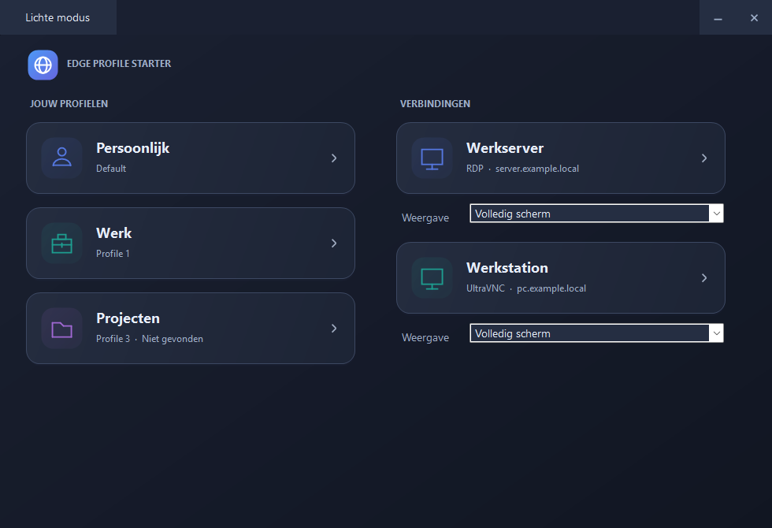

# Edge Profile Starter, gemaakt met AI

Een kleine Windows desktop-app om Microsoft Edge met een bestaand profiel te openen. Geen extra packages nodig; de app gebruikt .NET Framework 4.x van Windows en de geïnstalleerde Edge-browser.



De screenshot toont voorbeeldhosts voor RDP en UltraVNC met de weergavekeuze per verbinding.

Het venster heeft een eigen titelbalk met minimaliseren en sluiten. Versleep het via de bovenste strook. Maximaliseren is uitgeschakeld. Het eigen app-icoon is ingebouwd in de exe; de bronbestanden staan in `assets`. Met `generate-icon.ps1` kun je het icoon opnieuw genereren.

De launcher opent een nieuw Edge-venster en maximaliseert dit via Windows. De launcher blijft open, zodat je gedurende de dag opnieuw een profiel kunt kiezen. Er kan per Windows-gebruiker en sessie één launcher actief zijn, ook als je de exe vanuit verschillende mappen opent. Opnieuw starten brengt het bestaande venster naar voren en herstelt het als het geminimaliseerd is.

Via **Donkere modus** / **Lichte modus** linksboven wissel je het thema. De keuze wordt direct bewaard in `config.json` naast de exe (`"darkMode": true` of `false`) en bij de volgende start hersteld. Deze map moet beschrijfbaar zijn. Bouwen overschrijft bestaande instellingen en profielen niet.

## Bouwen en starten

Voer vanuit deze map uit:

```powershell
powershell.exe -NoProfile -ExecutionPolicy Bypass -File .\build.ps1
```

Dubbelklik daarna op `dist\EdgeProfileStarter.exe`. Je kunt de hele map `dist` naar een eigen locatie kopiëren. Houd `config.json` naast de exe. Maak eventueel via de Verkenner een snelkoppeling naar de exe op je bureaublad.

## Namen instellen

Open `dist\config.json` in een teksteditor, pas de namen aan en sla het bestand op. Start de app opnieuw om je wijzigingen te laden:

```json
{
  "windowTitle": "Mijn Edge-profielen",
  "darkMode": false,
  "profiles": [
    { "directory": "Default", "name": "Persoonlijk" },
    { "directory": "Profile 1", "name": "Werk" },
    { "directory": "Profile 3", "name": "Projecten" }
  ]
}
```

`name` is de naam van de knop. `directory` is de bestaande mapnaam onder `%LOCALAPPDATA%\Microsoft\Edge\User Data`. Voeg regels toe of verwijder ze om de knoppen te bepalen. De app verandert de profielnamen in Edge zelf niet. Ontbrekende profielen worden aangegeven en kunnen niet worden gestart; maak ze eerst aan in Edge.

Bij opnieuw bouwen blijft de configuratie in `dist` behouden. Het bestand in de hoofdmap is alleen het voorbeeld voor een eerste build. De launcher opent altijd een nieuw, gemaximaliseerd Edge-venster voor het gekozen profiel via `--new-window --start-maximized` en een expliciete Windows-maximaliseeropdracht. Bestaande Edge-vensters worden niet aangepast. Als binnen 15 seconden geen nieuw gemaximaliseerd venster gevonden wordt, blijft de launcher open met een foutmelding.

## RDP-sessies

In de rechterkolom **Verbindingen** staan RDP- en UltraVNC-sessies samen. De RDP-knoppen openen Remote Desktop-verbindingen rechtstreeks met `mstsc.exe /v:host`. Voeg in dezelfde `config.json` een lijst `rdpSessions` toe naast `profiles`:

```json
"rdpSessions": [
  { "name": "Werkserver", "host": "server.example.local" },
  { "name": "Testomgeving", "host": "192.168.1.20:3390" }
]
```

Gebruik een komma tussen `profiles` en `rdpSessions`. De host kan een naam of IP-adres zijn, eventueel met poortnummer. Start de launcher opnieuw na wijzigingen. Bestaande configuraties zonder `rdpSessions` blijven werken.

De launcher blijft open na het starten van een verbinding. Windows beheert de gebruikersnaam en aanmeldgegevens. Je kunt die bij het verbinden invoeren en, waar toegestaan, laten onthouden door Windows. De launcher maakt geen `.rdp`-bestanden en bewaart geen gebruikersnamen of wachtwoorden.

## UltraVNC

Installeer UltraVNC Viewer of gebruik een portable `vncviewer.exe`. Voeg naast `rdpSessions` de volgende velden toe aan `config.json`:

```json
"vncSessions": [
  { "name": "Werkstation", "host": "pc.example.local", "username": "DOMEIN\\tim" },
  { "name": "VNC testserver", "host": "192.168.1.30::5901" }
],
"ultraVncViewerPath": ""
```

Per UltraVNC-host kun je optioneel `username` instellen. De launcher geeft die mee als `-user "gebruikersnaam"`. Ontbreekt het veld of is het leeg, dan wordt `-user` weggelaten. Dit is bedoeld voor MS-Logon; de UltraVNC-server moet die authenticatiemethode ondersteunen. Een domeinnaam schrijf je in JSON als `"username": "DOMEIN\\tim"`. Wachtwoorden blijven buiten de configuratie.

De host volgt de UltraVNC-notatie: `host` voor de standaardverbinding, `host:1` voor display 1 en `host::5901` voor een expliciet poortnummer. Elke knop toont `UltraVNC` of `RDP` naast de host. De launcher blijft open.

Bij een leeg `ultraVncViewerPath` zoekt de app onder Program Files in `uvnc bvba\UltraVNC`, `uvnc\UltraVNC` en `UltraVNC`, daarna naast de launcher en in PATH. Voor een andere locatie stel je het volledige pad in, bijvoorbeeld:

```json
"ultraVncViewerPath": "C:\\Tools\\UltraVNC\\vncviewer.exe"
```

Relatieve paden worden ten opzichte van de exe opgelost. Omgevingsvariabelen zoals `%ProgramFiles%` zijn toegestaan. Als de viewer niet gevonden wordt, toont de app een melding bij het aanklikken; Edge en RDP blijven bruikbaar.

De app start de viewer rechtstreeks met `vncviewer.exe -connect host`. Authenticatie verloopt via UltraVNC Viewer; de launcher bewaart geen wachtwoord. Er worden geen verbindingsbestanden aangemaakt. Zie de [officiële UltraVNC-commandoregelopties](https://uvnc.com/docs/ultravnc-viewer/52-ultravnc-viewer-commandline-parameters.html).
## Weergave kiezen

Onder elke RDP- en UltraVNC-kaart kies je vóór het verbinden **Volledig scherm**, **Alle schermen** of **1280 × 1024**. Klik daarna op de kaart. Elke verbinding heeft een eigen keuze, standaard Volledig scherm; de keuze blijft tijdens het gebruik van de launcher beschikbaar en wordt bij herstart teruggezet.

| Keuze | RDP | UltraVNC |
| --- | --- | --- |
| Volledig scherm | `/f` | `-fullscreen -autoscaling` |
| Alle schermen | `/f /multimon`, met de lokale monitorindeling | Randloos viewer-venster over de volledige lokale desktop via `-noborder -notoolbar -autoscaling -position x y w h` |
| 1280 × 1024 | `/w:1280 /h:1024` | Viewer-venster via `-autoscaling -position 0 0 1280 1024` |

Bij UltraVNC verandert de keuze de lokale viewer, niet de resolutie of monitorindeling van de externe computer. Eventuele opgeslagen UltraVNC-standaardinstellingen worden door de viewer met commandoregelopties gecombineerd en kunnen het resultaat beïnvloeden. De RDP-server moet meerdere monitoren ondersteunen voor de optie Alle schermen.

Bronnen: [mstsc-opties](https://learn.microsoft.com/en-us/windows-server/administration/windows-commands/mstsc), [UltraVNC-opties](https://uvnc.com/docs/ultravnc-viewer/52-ultravnc-viewer-commandline-parameters.html), [UltraVNC-optieverwerking](https://github.com/ultravnc/UltraVNC/blob/main/vncviewer/VNCOptions.cpp).
## Code-indeling

- `src/Models`: de configuratie en profielgegevens.
- `src/Services/ConfigurationStore.cs`: laden, valideren en atomisch opslaan van `config.json`.
- `src/Services/VncLauncher.cs`: UltraVNC Viewer vinden en een verbinding starten.
- `src/Services/RdpLauncher.cs`: rechtstreeks mstsc starten met het ingestelde hostadres.
- `src/Services/EdgeLauncher.cs`: Edge starten en wachten op een gemaximaliseerd venster.
- `src/Services/SingleInstanceApplication.cs`: één actief appvenster en activeren bij opnieuw starten.
- `src/Windows`: Windows-vensters detecteren en maximaliseren.
- `src/UI`: het launchervenster, thema en de getekende controls.

Alle instellingen en profielen staan uitsluitend in `config.json`; er is geen conversiecode voor oudere configuratiebestanden.

## Controleren

```powershell
powershell.exe -NoProfile -ExecutionPolicy Bypass -File .\test.ps1
```

De controles testen configuratievalidatie, behoud van profielen en extra velden bij themawijzigingen, de levenscyclus van het venster, selectie van het nieuwe browservenster en het annuleren bij sluiten. De browseraansturing wordt met nagebootste start- en vensterfuncties getest; er wordt geen echte browser geopend.

De screenshot opnieuw maken, zonder de themakeuze in je configuratie te wijzigen:

```powershell
powershell.exe -NoProfile -ExecutionPolicy Bypass -File .\capture-screenshot.ps1
```
